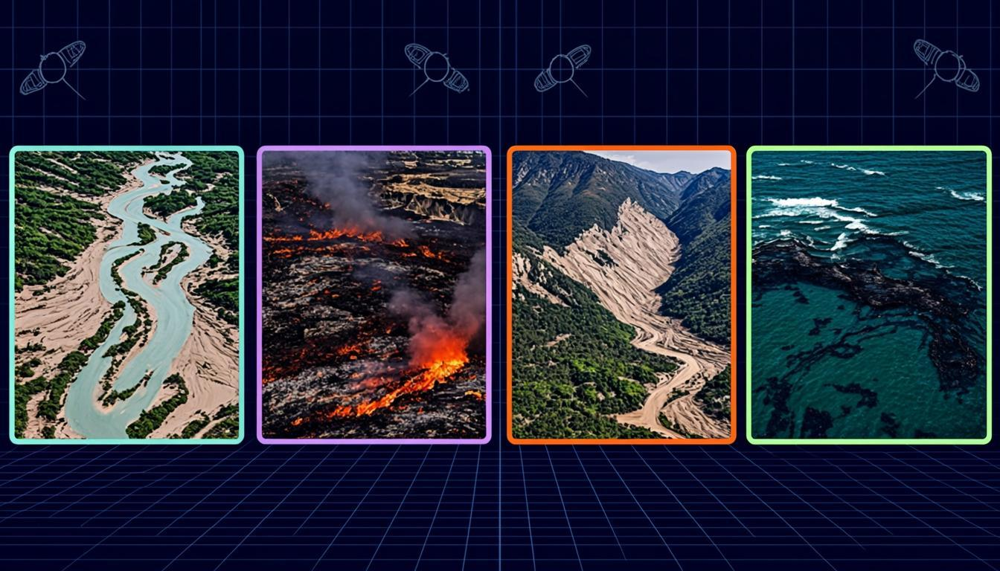
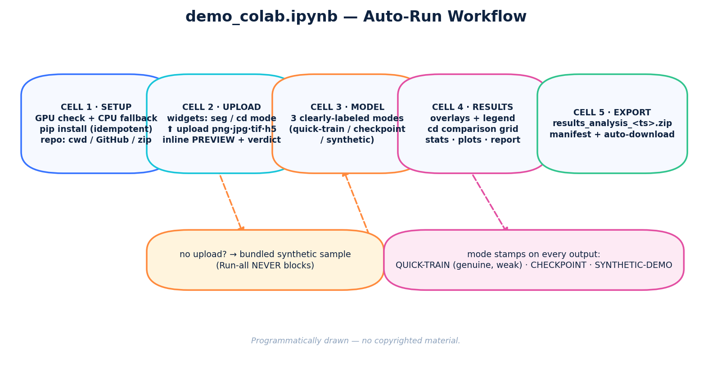
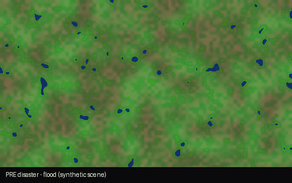
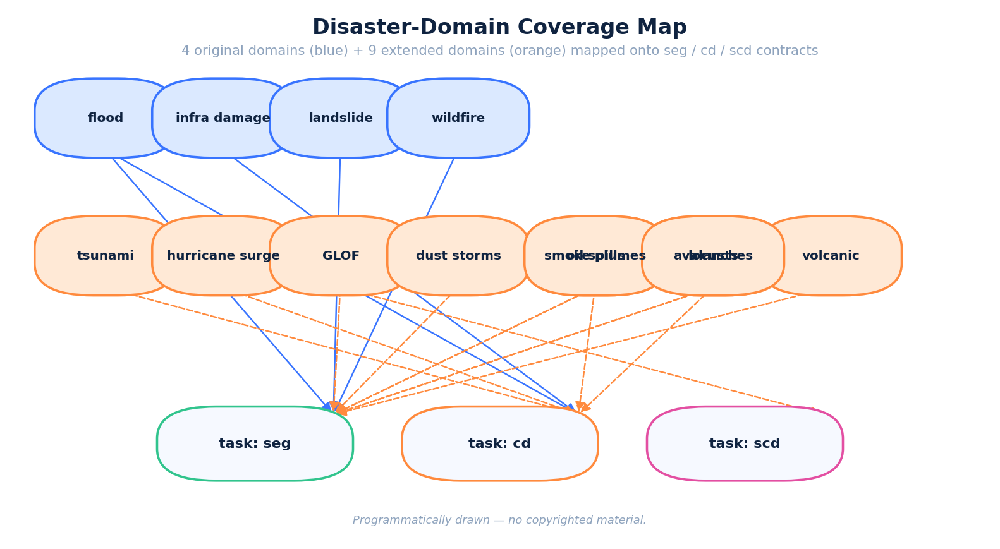
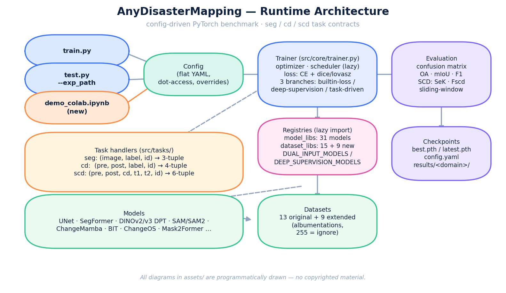

<div align="center">
<h1 align="center">🌍Any Disaster Mapping</h1>

<h3>Earth Observation for Disaster Mapping: Benchmarks, Methods, Challenges and Future Perspectives</h3>


[](https://colab.research.google.com/github/SyedRafiAhmedGIS/AnyDisasterMapping/blob/main/demo_colab.ipynb)




*Hero illustration: AI-generated, stylized, fictional — see [assets/CREDITS.md](assets/CREDITS.md).*

[Hongruixuan Chen](https://scholar.google.com/citations?user=XOk4Cf0AAAAJ)<sup>1,†</sup>, [Jian Song](https://scholar.google.com/citations?user=fx-27bQAAAAJ)<sup>1,†</sup>, [Weihao Xuan](https://scholar.google.com/citations?user=7e0W-2AAAAAJ)<sup>2,1,†</sup>, [Junjue Wang](https://scholar.google.com/citations?user=H58gKSAAAAAJ)<sup>2,†</sup>, [Heli Qi](https://scholar.google.com/citations?user=CH-rTXsAAAAJ)<sup>1</sup>, [Zeqi Zhou](https://scholar.google.com/citations?user=pqG03s0AAAAJ)<sup>3</sup>, [Pengyu Dai](https://scholar.google.com/citations?user=bxKhSZgAAAAJ)<sup>1,2</sup> <br> [Olivier Dietrich](https://scholar.google.com/citations?user=st6IqcsAAAAJ)<sup>4</sup>, [Erika Gutierrez](https://www.google.com/search?q=Erika+Gutierrez&oq=Erika+Gutierrez&gs_lcrp=EgRlZGdlKgYIABBFGDsyBggAEEUYOzIGCAEQABgeMgYIAhAAGB4yBggDEAAYHjIGCAQQABgeMgYIBRAAGB4yBggGEAAYHjIGCAcQRRg8MgcICBDrBxhA0gEHMjkxajBqNKgCALACAA&sourceid=chrome&ie=UTF-8)<sup>5</sup>, [Lars Bromley](https://www.google.com/search?q=Lars+Bromly&oq=Lars+Bromly&gs_lcrp=EgRlZGdlKgYIABBFGDsyBggAEEUYOzIJCAEQABgNGIAEMggIAhAAGA0YHjIKCAMQABiABBiiBDIHCAQQABjvBTIHCAUQABjvBTIKCAYQABiABBiiBDIGCAcQRRg70gEHMjQ0ajBqN6gCALACAA&sourceid=chrome&ie=UTF-8)<sup>5</sup>, [Edoardo Nemni](https://scholar.google.com/citations?user=eUo-LuAAAAAJ)<sup>6</sup>, [Yafei Ou](https://scholar.google.com/citations?user=2SyrQ1oAAAAJ)<sup>1</sup>, [Jie Zhao](https://scholar.google.com/citations?user=snOLm2MAAAAJ)<sup>7</sup>, [Zhuo Zheng](https://scholar.google.com/citations?user=CREpn_AAAAAJ)<sup>8</sup>, [Yonghao Xu](https://scholar.google.com/citations?user=sQs2ztAAAAAJ)<sup>9</sup> <br> [Ronny Hänsch](https://scholar.google.com/citations?user=mUlpUlUAAAAJ)<sup>10</sup>, [Wenzhe Jiao](https://scholar.google.com/citations?user=1v9ooFUAAAAJ)<sup>11</sup>, [Marco Chini](https://www.researchgate.net/profile/Marco-Chini)<sup>12</sup>, [Claudio Persello](https://scholar.google.com/citations?user=CI3bxVMAAAAJ)<sup>13</sup>, [Junshi Xia](https://scholar.google.com/citations?user=n1aKdTkAAAAJ)<sup>1</sup>, [Shijian Lu](https://scholar.google.com/citations?user=uYmK-A0AAAAJ)<sup>14</sup>, [Lixin Wang](https://scholar.google.com/citations?user=pQPtUesAAAAJ)<sup>15</sup>, [Zhe Zhu](https://scholar.google.com/citations?user=9ODFYW4AAAAJ)<sup>16</sup> <br>
[Evan Shelhamer](https://scholar.google.com/citations?user=-ltRSM0AAAAJ&hl=zh-CN)<sup>17</sup>, [Jocelyn Chanussot](https://scholar.google.com/citations?user=6owK2OQAAAAJ)<sup>18</sup>, [Konrad Schindler](https://scholar.google.com/citations?user=FZuNgqIAAAAJ)<sup>4</sup>, [Naoto Yokoya](https://scholar.google.com/citations?user=DJ2KOn8AAAAJ)<sup>2,1</sup>

<sup>†</sup>Equal contribution
<br>
<sup>1 </sup>RIKEN AIP, <sup>2 </sup>The University of Tokyo, <sup>3 </sup>Brown University, <sup>4 </sup>ETH Zurich, <sup>5 </sup>United Nations Satellite Centre
<br>
<sup>6 </sup>Barcelona School of Economics, <sup>7 </sup>Technical University of Munich, <sup>8 </sup>Stanford University, <sup>9 </sup>Linköping University 
<br>
<sup>10 </sup>German Aerospace Center (DLR), <sup>11 </sup>Texas A&amp;M University, <sup>12 </sup>Luxembourg Institute of Science and Technology
<br>
<sup>13 </sup>University of Twente, <sup>14 </sup>Nanyang Technological University, <sup>15 </sup>Indiana University Indianapolis
<br>
<sup>16 </sup>University of Connecticut, <sup>17 </sup>The University of British Columbia, <sup>18 </sup>Université Grenoble Alpes

[**Paper**](https://papers.ssrn.com/sol3/papers.cfm?abstract_id=6725082) | [**Launch Colab Demo**](#-interactive-colab-demo-no-code-needed) | [**Installation**](#installation) | [**Dataset Preparation**](#dataset-preparation) | [**Pretrained Weights**](#pretrained-weights) | [**Quick Start**](#quick-start) | [**Repo Layout**](#repository-layout) 

</div>

<!-- 
## Contents

- [Overview](#overview)
- [Installation](#installation)
- [Pretrained Weights](#pretrained-weights)
- [Quick Start](#quick-start)
- [Repository Layout](#repository-layout)
- [Dataset Preparation](#dataset-preparation)
- [Architecture And Extension](#architecture-and-extension) -->

## 🔭Overview
*Any Disaster Mapping* is the extended distribution built on the codebase released with the [review paper in EO-based disaster mapping](https://papers.ssrn.com/sol3/papers.cfm?abstract_id=6725082).

One of our key motivations is that current disaster mapping research is highly fragmented: benchmarks, tasks, and model implementations are often inconsistent across papers, making fair evaluation, reproduction, and further development unnecessarily difficult.

This repo unifies widely used disaster mapping benchmarks and representative deep learning models across major research directions, and provides a consistent training and evaluation pipeline for:
- Infrastructure damage
- Flood mapping
- Landslide segmentation
- Wildfire analysis
- **NEW (2026 extension):** oil spills · avalanches · volcanic eruptions · tsunami inundation · hurricane/cyclone surge · glacial lake outburst floods (GLOF) · dust/sand storms · wildfire smoke plumes · locust outbreaks — see the [extended domains table](#-extended-disaster-domains-9-new) and [docs/ADDITIONAL_DISASTERS.md](docs/ADDITIONAL_DISASTERS.md) for 21 more candidates.

It is designed to help researchers:
- Reproduce the results reported in our paper
- Evaluate models under a unified protocol
- Use strong baselines out of the box
- Build and test their own improvements with minimal engineering overhead

## 🚀 Interactive Colab Demo (no code needed)

**New to remote sensing?** Run [`demo_colab.ipynb`](demo_colab.ipynb) in Google Colab:

1. Click the **Open In Colab** badge at the top of this README.
2. `Runtime ▸ Run all` — the notebook auto-installs everything and **never blocks**: it uploads your satellite image (with an inline preview + suitability verdict) or falls back to a bundled synthetic sample.
3. Get segmentation overlays, change-detection comparison grids, class statistics, plots, and an auto-downloaded `results_analysis_<timestamp>.zip`.

Every result is stamped with the mode that produced it — **QUICK-TRAIN** (genuine, briefly-trained), **CHECKPOINT** (your `.pth`), or **SYNTHETIC-DEMO** (clearly-labeled heuristic). Nothing is faked.



### 🖼️ Live demo GIF



*Frames: PRE → POST → change heatmap → changed-area overlay → AI-illustration style. Procedurally generated fictional scene — **no real photos** (see [`assets/CREDITS.md`](assets/CREDITS.md)). Regenerate it with [`demo_gif_colab.ipynb`](demo_gif_colab.ipynb).*

### 📓 One-click Colab notebook collection (17 notebooks)

Every notebook: **runs automatically** (Run-all chains setup → demo data → inference → dashboard → export), shows a **preview of what to upload before you upload**, uses real **upload-widget buttons** with inline result previews, and **never blocks** — a 🛟 synthetic fallback fires when no file is given. Results are mode-stamped: **CHECKPOINT / QUICK-TRAIN / SYNTHETIC-DEMO**. Nothing is faked.

> **Engineering note (Round 5):** all 17 notebooks share one tested core — [`tools/colab_kit.py`](tools/colab_kit.py) — instead of repeating ~400 lines of setup in every file. When you run a notebook *from this repo*, the kit is imported locally; when a notebook runs **standalone in Colab**, its first cell fetches the kit pinned to the release tag `v5.0.0` (falling back to `main` with a clear warning only before the first release). The kit is torch-free and unit-tested in `tests/test_colab_kit.py`.

| notebook | covers | open in Colab |
|---|---|---|
| 🚀 Quickstart — all 13 domains, task picker | [`quickstart_colab.ipynb`](quickstart_colab.ipynb) | [](https://colab.research.google.com/github/SyedRafiAhmedGIS/AnyDisasterMapping/blob/main/quickstart_colab.ipynb) |
| 💧 Flood mapping (seg + cd) | [`flood_colab.ipynb`](flood_colab.ipynb) | [](https://colab.research.google.com/github/SyedRafiAhmedGIS/AnyDisasterMapping/blob/main/flood_colab.ipynb) |
| 🔥 Wildfire & burn scar (seg + cd) | [`wildfire_colab.ipynb`](wildfire_colab.ipynb) | [](https://colab.research.google.com/github/SyedRafiAhmedGIS/AnyDisasterMapping/blob/main/wildfire_colab.ipynb) |
| 🌊 Tsunami inundation (cd) | [`tsunami_colab.ipynb`](tsunami_colab.ipynb) | [](https://colab.research.google.com/github/SyedRafiAhmedGIS/AnyDisasterMapping/blob/main/tsunami_colab.ipynb) |
| 🌀 Hurricane damage & surge (cd) | [`hurricane_colab.ipynb`](hurricane_colab.ipynb) | [](https://colab.research.google.com/github/SyedRafiAhmedGIS/AnyDisasterMapping/blob/main/hurricane_colab.ipynb) |
| ⛰️ Landslide segmentation (seg) | [`landslide_colab.ipynb`](landslide_colab.ipynb) | [](https://colab.research.google.com/github/SyedRafiAhmedGIS/AnyDisasterMapping/blob/main/landslide_colab.ipynb) |
| 🌋 Volcanic eruption (seg) | [`volcano_colab.ipynb`](volcano_colab.ipynb) | [](https://colab.research.google.com/github/SyedRafiAhmedGIS/AnyDisasterMapping/blob/main/volcano_colab.ipynb) |
| 🆚 Change detection — BIT/ChangeOS style + CHECKPOINT mode | [`change_detection_colab.ipynb`](change_detection_colab.ipynb) | [](https://colab.research.google.com/github/SyedRafiAhmedGIS/AnyDisasterMapping/blob/main/change_detection_colab.ipynb) |
| 🛰️ Satellite fine-tuning (TinyUNetSiam quick-train) | [`satellite_finetune_colab.ipynb`](satellite_finetune_colab.ipynb) | [](https://colab.research.google.com/github/SyedRafiAhmedGIS/AnyDisasterMapping/blob/main/satellite_finetune_colab.ipynb) |
| 🎨 AI illustration images (no real photos) | [`ai_images_colab.ipynb`](ai_images_colab.ipynb) | [](https://colab.research.google.com/github/SyedRafiAhmedGIS/AnyDisasterMapping/blob/main/ai_images_colab.ipynb) |
| 🎞️ Demo GIF builder for the README | [`demo_gif_colab.ipynb`](demo_gif_colab.ipynb) | [](https://colab.research.google.com/github/SyedRafiAhmedGIS/AnyDisasterMapping/blob/main/demo_gif_colab.ipynb) |
| 📦 Batch inference (grid + CSV) | [`batch_inference_colab.ipynb`](batch_inference_colab.ipynb) | [](https://colab.research.google.com/github/SyedRafiAhmedGIS/AnyDisasterMapping/blob/main/batch_inference_colab.ipynb) |
| 🏋️ Checkpoint zoo — real weights → real inference | [`checkpoint_zoo_colab.ipynb`](checkpoint_zoo_colab.ipynb) | [](https://colab.research.google.com/github/SyedRafiAhmedGIS/AnyDisasterMapping/blob/main/checkpoint_zoo_colab.ipynb) |
| 📥 Dataset access hub — all 24 registered benchmarks | [`dataset_download_colab.ipynb`](dataset_download_colab.ipynb) | [](https://colab.research.google.com/github/SyedRafiAhmedGIS/AnyDisasterMapping/blob/main/dataset_download_colab.ipynb) |
| 📊 Evaluation lab — OA · mIoU · per-class F1 · confusion matrices | [`evaluation_metrics_colab.ipynb`](evaluation_metrics_colab.ipynb) | [](https://colab.research.google.com/github/SyedRafiAhmedGIS/AnyDisasterMapping/blob/main/evaluation_metrics_colab.ipynb) |
| 🧩 Semantic change detection (SCD) | [`scd_colab.ipynb`](scd_colab.ipynb) | [](https://colab.research.google.com/github/SyedRafiAhmedGIS/AnyDisasterMapping/blob/main/scd_colab.ipynb) |

> Also keep using the original all-in-one [`demo_colab.ipynb`](demo_colab.ipynb).

### 🌐 Gradio web demo (local or Hugging Face Space)

```bash
pip install -r gradio_demo/requirements.txt
python gradio_demo/app.py        # → http://127.0.0.1:7860
```

Four tabs: synthetic pre/post demos (no upload needed), your own change-detection pairs, single-scene segmentation, and watermarked **AI illustrations**. Deploy free: create a Hugging Face **Space** (Gradio SDK) and drop the [`gradio_demo/`](gradio_demo/) folder in.

### 📚 Per-domain guides

| guide | guide | guide |
|---|---|---|
| 💧 [Flood](docs/domains/flood.md) | 🔥 [Wildfire](docs/domains/wildfire.md) | 🌊 [Tsunami](docs/domains/tsunami.md) |
| 🌀 [Hurricane](docs/domains/hurricane.md) | ⛰️ [Landslide](docs/domains/landslide.md) | 🌋 [Volcano](docs/domains/volcano.md) |
| 🛢️ [Oil spill](docs/domains/oil_spill.md) | 🏔️ [Avalanche](docs/domains/avalanche.md) | 🧊 [GLOF](docs/domains/glof.md) |
| 🏜️ [Dust storm](docs/domains/dust_storm.md) | 💨 [Smoke plume](docs/domains/smoke_plume.md) | 🦗 [Locust](docs/domains/locust.md) · 🏚️ [Infra damage](docs/domains/infra_damage.md) |

## 🗺️ Extended Disaster Domains (9 NEW)

<table>
<tr><th>Disaster</th><th>Output</th><th>Task</th><th>Sensor</th><th>Reference datasets</th></tr>
<tr><td>🛢️ Oil spills</td><td>Slick extent vs look-alikes</td><td>seg + cd</td><td>SAR (VV/VH)</td><td>Krestenitis et al. benchmark; SAR Oil Spill Dataset I; CSIRO S1; OSCD</td></tr>
<tr><td>🏔️ Avalanches</td><td>Debris outlines</td><td>seg</td><td>Optical/SAR</td><td>Swiss SLF open-data outlines; 2026 SAR multi-region benchmark</td></tr>
<tr><td>🌋 Volcanic eruptions</td><td>Lava flows, vents, fumaroles</td><td>seg</td><td>Optical+thermal</td><td>PyRawS (ESA Phi-Lab); Sundhnúkur mappings; xBD eruption events</td></tr>
<tr><td>🌊 Tsunami inundation</td><td>Inundation extent</td><td>cd</td><td>Optical/SAR</td><td>xBD tsunami events; MMFlood</td></tr>
<tr><td>🌀 Hurricane surge</td><td>Storm-surge inundation</td><td>cd</td><td>SAR (VV/VH)</td><td>Sen1Floods11; xBD wind damage</td></tr>
<tr><td>🧊 GLOF</td><td>Lake extent + expansion</td><td>seg + <b>scd</b></td><td>Optical</td><td>ICIMOD glacial-lake inventories</td></tr>
<tr><td>🏜️ Dust/sand storms</td><td>Plume segmentation</td><td>seg</td><td>Optical</td><td>MODIS/VIIRS dust-detection studies</td></tr>
<tr><td>💨 Wildfire smoke</td><td>Smoke vs cloud vs clear</td><td>seg</td><td>Optical</td><td>MODIS/VIIRS/GOES smoke-masked datasets</td></tr>
<tr><td>🦗 Locust outbreaks</td><td>Habitat / affected cropland</td><td>seg + cd</td><td>Optical</td><td>FAO DLIS records + Sentinel-2 (derived labels)</td></tr>
</table>

Each domain ships: dataset adapter (`src/datasets/`), lazy-import registry entries, 2 configs (lightweight + modern), a data-prep guide (`scripts/data_prep/<domain>/README.md`), a sanity-check script, and a `make_dummy.py` synthetic generator so the full train→test loop runs **without downloading any real data**. Verify everything at once:

```bash
python scripts/smoke_test_all_domains.py          # 1-epoch dummy train+test per domain
python scripts/data_prep/sanity_check.py --list   # per-domain dataset validator
```

> ℹ️ The GLOF configs include the repo's **first shipped `task: scd` configuration** (`configs/glof/icimod/scd_changemamba_scd.yaml`).



### Quickstart for beginners (5 minutes)
```bash
pip install -e .
python scripts/data_prep/volcano/make_dummy.py --out data/volcano/PYRAWS   # synthetic data
python train.py --config configs/volcano/volcano_pyraws/seg_unet.yaml \
    --override training.num_epochs 2 dataset.train.dataset_path data/volcano/PYRAWS \
    dataset.train.data_list_path data/volcano/PYRAWS/train.txt \
    dataset.val.dataset_path data/volcano/PYRAWS dataset.val.data_list_path data/volcano/PYRAWS/val.txt
```
Or skip the terminal entirely: run the Colab notebook above.

> 🔁 **Reproducibility.** Training is seeded (`seed`, default 42) but not
> bit-for-bit deterministic by default, because cudnn benchmark autotuning is
> a large speed win for fixed-size tiles. Add
> `--override training.deterministic true` for bit-for-bit reproducible runs
> (slower; sets `cudnn.deterministic=True`, `cudnn.benchmark=False` and
> `torch.use_deterministic_algorithms(warn_only=True)`).

### 📌 Next steps you might want
- 🎞️ **Demo GIF** in the README (auto-recorded from a Colab run)
- ✂️ **Notebook split** into smaller sections (Setup / Upload / Train / Results / Export as separate .ipynb files)
- 🌐 **README translations** (中文 · Español · Français · हिन्दी · Português · العربية · 日本語)
- 🛰️ **Satellite-image fine-tuning tutorial section** + dataset walkthrough (bring your own GeoTIFF → label → fine-tune → evaluate)
- ➕ **21 more disaster-domain blueprints** are already catalogued in [docs/ADDITIONAL_DISASTERS.md](docs/ADDITIONAL_DISASTERS.md) (earthquake damage, calving fronts, algal blooms, …)
- 🤖 GitHub Actions CI running the smoke test on every push

## 🛠️Installation

Base environment and optional model-specific extras.

```bash
# NOTE: --index-url should match the version of your local CUDA toolkit for compiling ChangeMamba kernels (cu126 is just an example)
pip install torch torchvision xformers --index-url https://download.pytorch.org/whl/cu126
pip install -e .
```

Some models require optional extras:

- ChangeMamba selective scan kernel:
  ```bash
  # run `conda install -c conda-forge gcc=13 gxx=13 -y` if you meet GCC issues
  cd src/models/ChangeMamba/kernels/selective_scan
  pip install . --no-build-isolation
  ```
- Local pretrained checkpoints under `pretrained_weight/` for model families such as SegFormer, HRNet, SAM/SAM2, DINOv3, HyperSigma, SkySense, SpectralGPT, and ChangeMamba. See [Pretrained Weights](#pretrained-weights) below.

## 🧪Dataset Preparation

Dataset preparation guides are organized by disaster domain:

- Infrastructure damage: [scripts/data_prep/infra_damage/README.md](scripts/data_prep/infra_damage/README.md)
- Flood: [scripts/data_prep/flood/README.md](scripts/data_prep/flood/README.md)
- Landslide: [scripts/data_prep/landslide/README.md](scripts/data_prep/landslide/README.md)
- Wildfire: [scripts/data_prep/wildfire/README.md](scripts/data_prep/wildfire/README.md)
- **Extended domains (new):** [oil spill](scripts/data_prep/oil_spill/README.md) · [avalanche](scripts/data_prep/avalanche/README.md) · [volcano](scripts/data_prep/volcano/README.md) · [tsunami](scripts/data_prep/tsunami/README.md) · [hurricane](scripts/data_prep/hurricane/README.md) · [GLOF](scripts/data_prep/glof/README.md) · [dust storm](scripts/data_prep/dust_storm/README.md) · [smoke plume](scripts/data_prep/smoke_plume/README.md) · [locust](scripts/data_prep/locust/README.md)
- Generic validator: `python scripts/data_prep/sanity_check.py --domain <domain> --path <dataset_root>`


## 📦Pretrained Weights

**Task checkpoints (model zoo) are hosted on Hugging Face: [SyedRafiAhmedGIS/AnyDisasterMapping-weights](https://huggingface.co/SyedRafiAhmedGIS/AnyDisasterMapping-weights)** — pull any zoo checkpoint with `python tools/download_weights.py --model unet` (SHA256 auto-verified). Currently published: `unet.pth` (oil-spill demo checkpoint).

 Recommended local checkpoint layout for the supported model zoo.

Task-checkpoints from the project release can be listed and pulled with
`python tools/download_weights.py --list` (see docs/TOOLS.md). Foundation
backbones below are fetched manually.

Create the local checkpoint directory first:

```bash
mkdir -p pretrained_weight
```

### Direct Downloads

```bash
# pretrain-vit-base-e199.pth
wget -O pretrained_weight/pretrain-vit-base-e199.pth \
  https://zenodo.org/records/7338613/files/pretrain-vit-base-e199.pth

# SpectralGPT+.pth
wget -O "pretrained_weight/SpectralGPT+.pth" \
  "https://zenodo.org/records/8412455/files/SpectralGPT+.pth?download=1"

# spec-vit-base-ultra-checkpoint-1599.pth
wget -O pretrained_weight/spec-vit-base-ultra-checkpoint-1599.pth \
  https://huggingface.co/WHU-Sigma/HyperSIGMA/resolve/main/spec-vit-base-ultra-checkpoint-1599.pth

huggingface-cli download UTokyo-Yokoya-Lab/AnyDisaster-Pretrained_Weight \
  vssm_tiny_0230_ckpt_epoch_262.pth --local-dir pretrained_weight --local-dir-use-symlinks False
```

### Additional Upstream Checkpoints

- DINOv3
  Source: https://ai.meta.com/resources/models-and-libraries/dinov3-downloads/
  Download and save as:
  - `dinov3_vitb16_pretrain_lvd1689m-73cec8be.pth` (ViT-B/16, LVD-1689M)
  - `dinov3_vitl16_pretrain_lvd1689m-8aa4cbdd.pth` (ViT-L/16, LVD-1689M)
  - `dinov3_vitl16_pretrain_sat493m-eadcf0ff.pth` (ViT-L/16, SAT-493M)

- SAM v1
  Source: https://github.com/facebookresearch/segment-anything
  Download and save as:
  - `sam_vit_b_01ec64.pth` (SAM ViT-B)
  - `sam_vit_l_0b3195.pth` (SAM ViT-L)

- SAM 2.1
  Source: https://github.com/facebookresearch/sam2
  Download and save as:
  - `sam2.1_hiera_small.pt` (SAM 2.1 Hiera-Small)
  - `sam2.1_hiera_base_plus.pt` (SAM 2.1 Hiera-Base+)

- SegFormer MiT encoders
  Source: https://github.com/NVlabs/SegFormer
  Download and save as:
  - `mit_b0.pth`
  - `mit_b1.pth`
  - `mit_b2.pth`
  - `mit_b3.pth`
  - `mit_b4.pth`
  - `mit_b5.pth`

- HyperSIGMA spatial backbone
  Source: https://huggingface.co/WHU-Sigma/HyperSIGMA
  Download the upstream file, rename, and save as:
  - `HSI_spatial_checkpoint-1600.pth`

- SkySense backbone
  Source:
  - https://github.com/Jack-bo1220/SkySense
  - https://www.notion.so/SkySense-Checkpoints-a7fcff6ce29a4647a08c7fe416910509
  Select the `hr` (high-resolution RGB / RGBNIR) variant, not the `s2` Sentinel-2 variant.
  Save as:
  - `skysense_model_backbone_hr.pth`
  For commercial use, contact the authors (`yansheng.li@whu.edu.cn`).

After completing all downloads, `pretrained_weight/` should contain:

```text
pretrained_weight/
├── dinov3_vitb16_pretrain_lvd1689m-73cec8be.pth
├── dinov3_vitl16_pretrain_lvd1689m-8aa4cbdd.pth
├── dinov3_vitl16_pretrain_sat493m-eadcf0ff.pth
├── HSI_spatial_checkpoint-1600.pth
├── mit_b0.pth
├── mit_b1.pth
├── mit_b2.pth
├── mit_b3.pth
├── mit_b4.pth
├── mit_b5.pth
├── pretrain-vit-base-e199.pth
├── sam2.1_hiera_base_plus.pt
├── sam2.1_hiera_small.pt
├── sam_vit_b_01ec64.pth
├── sam_vit_l_0b3195.pth
├── skysense_model_backbone_hr.pth
├── spec-vit-base-ultra-checkpoint-1599.pth
├── SpectralGPT+.pth
└── vssm_tiny_0230_ckpt_epoch_262.pth
```

## 🚀 Quick Start

Minimal training and evaluation commands.

### Train

Train with a YAML config:

```bash
python train.py --config configs/infra/xbd/unet.yaml
```

### Evaluate

Evaluate an experiment directory:

```bash
python test.py --exp_path results/xbd/unet
```

### Deploy (ONNX / TorchScript / Docker / Gradio)

```bash
pip install -e ".[export]"
python tools/export_onnx.py --exp_path results/xbd/unet --torchscript --check
python tools/download_weights.py --list     # HF weights release
docker build -t anydisaster .               # CPU/GPU image (+ `--target demo` for Gradio)
```

Full guide: **docs/TOOLS.md** · docs site: `pip install mkdocs mkdocs-material && mkdocs build`

## 🗂️Repository Layout

 Main directories and what they are responsible for:

- `src/core/`: trainer, config loader, registry, augmentation, metrics
- `src/tasks/`: task handlers for segmentation, change detection, and semantic change detection
- `src/datasets/`: dataset adapters and runtime data contracts (13 original + 9 extended)
- `src/models/`: model wrappers and vendored third-party implementations
- `configs/`: experiment configs grouped by domain and dataset (now including 9 extended domains)
- `scripts/data_prep/`: dataset preparation guides, helper scripts, sanity checks, and synthetic dummy generators
- `scripts/smoke_test_all_domains.py`: end-to-end 1-epoch smoke test for all 9 extended domains
- `demo_colab.ipynb`: zero-edit interactive demo (upload → quick-train → dashboard → export)
- `assets/`: AI-generated / programmatically drawn illustrations (see `assets/CREDITS.md`)
- `docs/`: architecture notes, extension guidance, and the additional-disasters catalog




## 🏗️Architecture And Extension

Internal runtime design and extension entry points.

- Architecture overview: [docs/ARCHITECTURE.md](docs/ARCHITECTURE.md)
- Extension guide: [docs/EXTENSION_GUIDE.md](docs/EXTENSION_GUIDE.md)

## 📜Reference
If this code repo contributes to your research, please cite this repository (BibTeX below), and the upstream benchmark paper it builds on ⭐️ :)
```
@software{ahmed2026anydisastermappingextended,
  author  = {Ahmed, Syed Rafi},
  title   = {AnyDisasterMapping -- extended: a unified PyTorch codebase for Earth-observation disaster mapping},
  year    = {2026},
  version = {v5.0.0},
  url     = {https://github.com/SyedRafiAhmedGIS/AnyDisasterMapping}
}

**Upstream benchmark paper this project builds on (Chen et al. 2026):**

@misc{chen2026earthobservationdisastermapping,
  author       = {Chen, Hongruixuan and Song, Jian and Xuan, Weihao and Wang, Junjue
                  and Qi, Heli and Zhou, Zeqi and Dai, Pengyu and Dietrich, Olivier
                  and Gutierrez, Erika and Bromly, Lars and Nemni, Edoardo and Ou, Yafei
                  and Zhao, Jie and Zheng, Zhuo and Xu, Yonghao and H{\"a}nsch, Ronny
                  and Jiao, Wenzhe and Chini, Marco and Persello, Claudio and Xia, Junshi
                  and Lu, Shijian and Wang, Lixin and Zhu, Zhe and Shelhamer, Evan
                  and Chanussot, Jocelyn and Schindler, Konrad and Yokoya, Naoto},
  title        = {Earth Observation for Disaster Mapping: Benchmarks, Methods, Challenges and Future Perspectives},
  year         = {2026},
  month        = {may},
  note         = {SSRN preprint},
  doi          = {10.2139/ssrn.6725082},
  url          = {https://ssrn.com/abstract=6725082}
}
```


## 🙋Q & A
For any questions, please feel free to leave it in the issue section or send inquiry email to qschrx@gmail.com.

## License

**Licensing decision (2026-10-22): this is a RESEARCH-ONLY distribution.**
The original code is Apache-2.0 (`LICENSE`), but the bundled third-party
model code keeps its own terms and several components are **more
restrictive** — verified against each upstream release:

- **Non-commercial / research-only:** BIT (upstream README: "non-commercial
  and research purposes only"), DSIFN (same), SegFormer (NVIDIA Source Code
  License), SatMAE (CC BY-NC 4.0), SpectralGPT (GPL-3.0 code with embedded
  MAE code under CC BY-NC 4.0), DINOv3 (Meta's DINOv3 License Agreement),
  ChangeOS (upstream ships **no license** — all rights reserved by default).
- **Copy-left:** UNetFormer (upstream GeoSeg is GPL-3.0) — commercial use
  only if the combined distribution stays GPL-3.0-compatible.
- **Commercial-friendly:** RS3Mamba, FarSeg, HyperSigma, ChangeMamba,
  SAM, SAM2, HRNet, Swin, CLIP, SiamCRNN (Apache-2.0 / MIT).

Do **not** use this repository commercially as-is: remove the restricted
components (see the ⚠ rows in [`THIRD_PARTY_NOTICES.md`](THIRD_PARTY_NOTICES.md))
or obtain permission from their owners. Every component's provenance and
terms are documented in [`NOTICE`](NOTICE),
[`THIRD_PARTY_NOTICES.md`](THIRD_PARTY_NOTICES.md) and
[`third_party_licenses/`](third_party_licenses/) (upstream texts, verified
2026-10-22).
